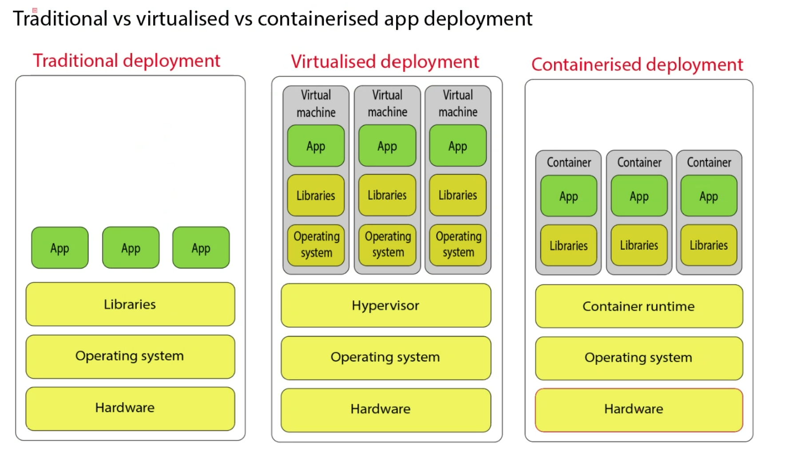

Intro to  microservices, containers and Docker

* Differences between virtualisation and containerisation
  * What is usually included in a container vs virtual machine?
  
  * Benefits of each, especially a virtual machine over the traditional architecture
* Microservices
  * What are they?
    * software architectural design pattern
    * a way to break app code into smaller parts that run (but still need to talk to each other)
  * How are they made possible?
    * using containers (but they don't have to)
  * Benefits
    * can make an application more portable and easy to scale
* Docker
  * What is it?
    * command-line utility to interact with it
    * managing, running your containers
  * Where does it come from?
    * Founded in 2011
    * First show to the public at PyCon in 2013
  * Why Docker?
    * Podman(short for pod manager)
    * open-source
    * some advantages over Docker
      * Deamonless - you don't need a service running like docker
      * better security that docker (it can run)
      * already installed with many distributions of Linux
      * most of the command have same syntax as docker
    * Disadvantages
      * Docker is more well-known
  * Alternatives
  * How it works (Docker architecture/API)
  * Success story using Docker

