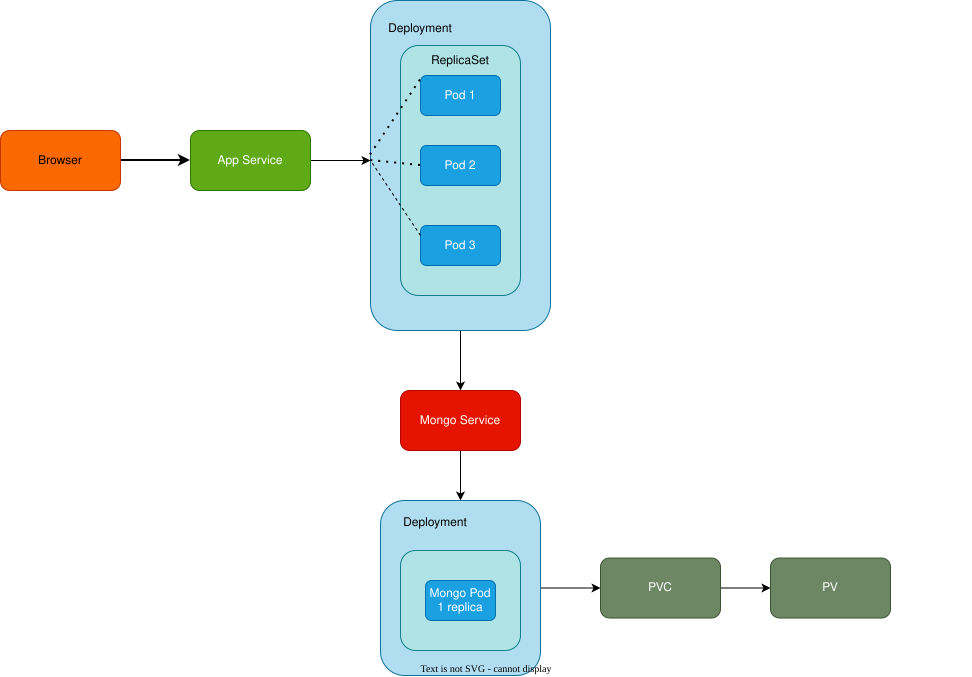

# Deploying the Tic Tac Toe App on Kubernetes

I deployed my Node.js Tic Tac Toe (TTT) app on a local Kubernetes cluster in two stages:

1. **App only:** 3 replicas, exposed with a NodePort service
2. **App + database:** the same app, plus a Mongo database (1 replica)

My notes from the code-along are in [k8s-code-along.md](k8s-code-along.md).

---

## Prerequisites

- App image on Docker Hub: `thantzintun234/tech613-tttapp:1.2.0`
- Database image: `mongo:7.0` (the official Mongo image)

---

## Architecture


- The Browser reaches the app through the App Service (NodePort), at `localhost:30001`.
- The App Service sends traffic to the 3 app pods.
- The Deployment keeps 3 identical app pods running, using a ReplicaSet
- The app pods talk to Mongo through the Mongo Service (ClusterIP). It is internal only, so nothing outside the cluster can reach the database.
- The Mongo Deployment runs 1 Mongo pod.
- The Mongo pod uses a PVC (a request for storage), which is bound to a PV (the real storage).
- The data stays in the PV, so it survives if the Mongo pod is deleted and re-created.

---

## Part 1: App only

Folder: `yaml-definitions/local-ttt-app-deploy`

I copied the Nginx files and changed the names, labels, image and ports.

### `ttt-deploy.yml`

```yaml
apiVersion: apps/v1
kind: Deployment
metadata:
  name: ttt-app-deployment
spec:
  replicas: 3
  selector:
    matchLabels:
      app: ttt-app
  template:
    metadata:
      labels:
        app: ttt-app
    spec:
      containers:
        - name: ttt-app
          image: thantzintun234/tech613-tttapp:1.2.0
          ports:
            - containerPort: 3000
```

### `ttt-service.yml`

```yaml
apiVersion: v1
kind: Service
metadata:
  name: ttt-service
  namespace: default
spec:
  ports:
  - nodePort: 30001 # range is 30000-32767
    port: 3000
    targetPort: 3000
  selector:
    app: ttt-app  # must match the deployment label
  type: NodePort
```

### Deploy

```bash
kubectl apply -f ttt-deploy.yml
kubectl apply -f ttt-service.yml
kubectl get all
```
---

## Part 2: App + database

Folder: `yaml-definitions/local-ttt-app-db-deploy`

I kept the app files and added two Mongo files.

### `mongo-deploy.yml`

```yaml
apiVersion: apps/v1
kind: Deployment
metadata:
  name: mongo-deployment
spec:
  replicas: 1
  selector:
    matchLabels:
      app: mongo
  template:
    metadata:
      labels:
        app: mongo
    spec:
      containers:
        - name: mongo
          image: mongo:7.0
          ports:
            - containerPort: 27017
```

### `mongo-service.yml`

```yaml
apiVersion: v1
kind: Service
metadata:
  name: mongo-service
spec:
  type: ClusterIP   # internal only
  selector:
    app: mongo
  ports:
    - port: 27017
      targetPort: 27017
```

### Change in `ttt-deploy.yml`

I added an environment variable so the app can find the database:

```yaml
          env:
            - name: MONGODB_URI
              value: mongodb://mongo-service:27017/tictactoe
```

In Docker Compose the host was `mongo`. In Kubernetes it is the service name, `mongo-service`.

### Deploy

```bash
kubectl apply -f mongo-deploy.yml
kubectl apply -f mongo-service.yml
kubectl apply -f ttt-deploy.yml
kubectl apply -f ttt-service.yml
kubectl get all
```


## What I learned

- Kubernetes keeps the **desired state** (3 replicas) and replaces pods that fail.
- A **service** gives pods a stable address, and it finds them using **labels**.
- Containers in the cluster reach each other by **service name**, not by IP.
- Use **NodePort** to expose the app, and **ClusterIP** to keep the database private.
- Mongo has no volume here, so its data is lost if the pod is replaced. A persistent volume would fix that.

---

## Part 3: Persistent storage for Mongo (PV and PVC)

Folder: `yaml-definitions/local-ttt-app-db-deploy`

In part 2, the database data was lost if the Mongo pod was deleted, because pod storage is temporary. To fix that, I added a **PV** and a **PVC**.

### What are PV and PVC?

| | Meaning | Simple idea |
|---|---|---|
| **PV** (PersistentVolume) | A piece of storage in the cluster | The storage unit |
| **PVC** (PersistentVolumeClaim) | A pod's request for storage | The rental request |

```
Mongo pod → PVC (request) → PV (real storage)
```

If the Mongo pod is deleted, the PV keeps the data. The new pod claims the same storage and finds its old data.

I kept the size small (`100Mi`, about 105 MB) because the scoreboard data is tiny and the task said not to over-allocate.

### `mongo-pv.yml`

```yaml
apiVersion: v1
kind: PersistentVolume
metadata:
  name: mongo-pv
spec:
  capacity:
    storage: 100Mi
  accessModes:
    - ReadWriteOnce
  storageClassName: manual
  hostPath:
    path: /data/mongo
```

### `mongo-pvc.yml`

```yaml
apiVersion: v1
kind: PersistentVolumeClaim
metadata:
  name: mongo-pvc
spec:
  storageClassName: manual
  accessModes:
    - ReadWriteOnce
  resources:
    requests:
      storage: 100Mi
```

### Change in `mongo-deploy.yml`

The pod uses the PVC and mounts it at `/data/db`, the folder where Mongo saves its data:

```yaml
    spec:
      containers:
        - name: mongo
          image: mongo:7.0
          ports:
            - containerPort: 27017
          volumeMounts:
            - name: mongo-storage
              mountPath: /data/db
      volumes:
        - name: mongo-storage
          persistentVolumeClaim:
            claimName: mongo-pvc
```

### How the files link

| Link | What must match |
|---|---|
| PVC → PV | Same `storageClassName` and `accessModes`. The PV must be at least as big as the PVC's request. |
| Pod → PVC | `claimName` in the deployment matches the PVC's `name` (`mongo-pvc`) |
| Mount → volume | `volumeMounts.name` matches `volumes.name` (`mongo-storage`) |

### Deploy

The PV and PVC go first, so the storage is ready before the database starts:

```bash
kubectl apply -f mongo-pv.yml
kubectl apply -f mongo-pvc.yml
kubectl apply -f mongo-deploy.yml
kubectl apply -f mongo-service.yml
kubectl apply -f ttt-deploy.yml
kubectl apply -f ttt-service.yml
```

### Check the storage

```bash
kubectl get pv
kubectl get pvc
```

The PVC status should say `Bound`, which means it has been matched to the PV.


### Test that the data stays

1. Open the app at `http://localhost:30001` and note the scoreboard data
2. Delete the Mongo deployment: `kubectl delete -f mongo-deploy.yml`
3. Re-create it: `kubectl apply -f mongo-deploy.yml`
4. Refresh the app and check the scoreboard shows the same data

### Clean up

PVs stay in the cluster until they are removed, so I deleted them at the end. PVC first, then PV:

```bash
kubectl delete -f ttt-service.yml
kubectl delete -f ttt-deploy.yml
kubectl delete -f mongo-service.yml
kubectl delete -f mongo-deploy.yml
kubectl delete -f mongo-pvc.yml
kubectl delete -f mongo-pv.yml
kubectl get pv
```

### Notes

- I used separate files so that deleting `mongo-deploy.yml` doesn't delete the storage.


